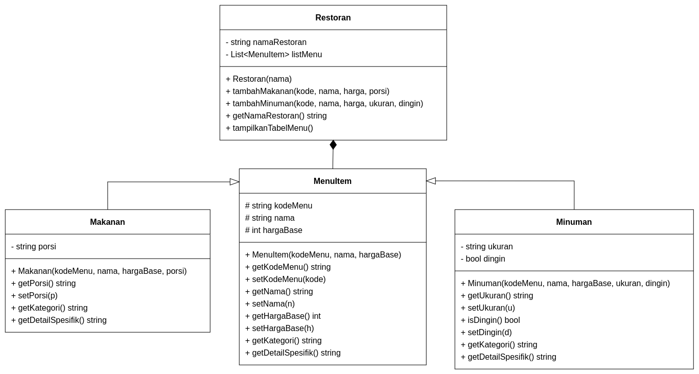
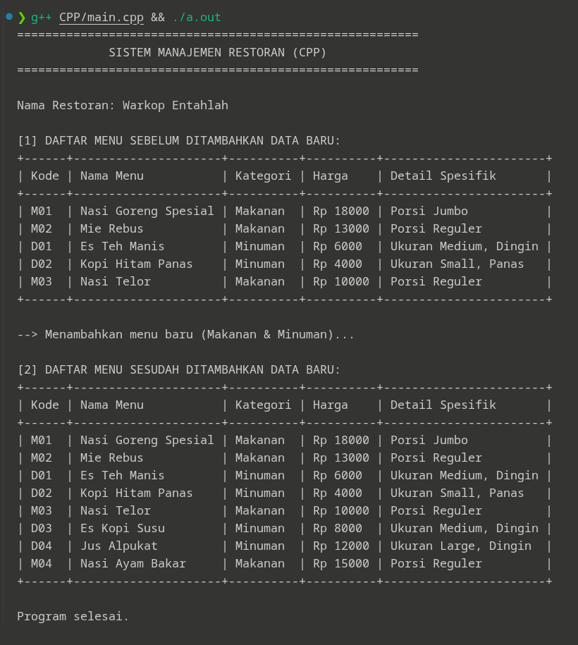
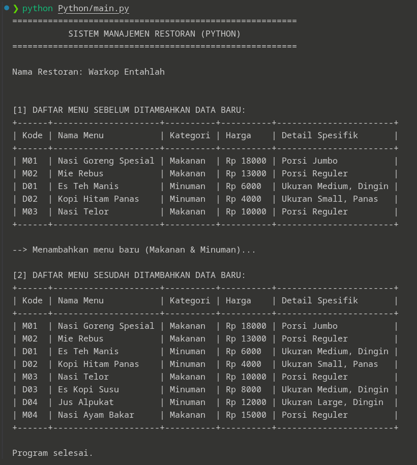
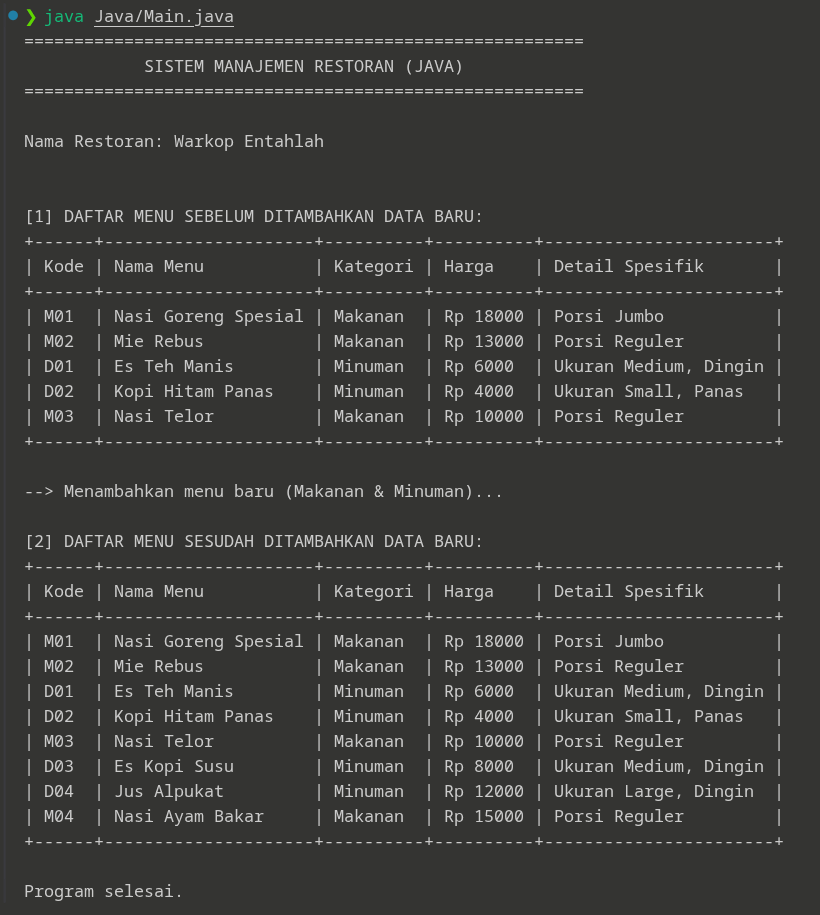

# README.md

## Janji

Saya Muhammad Rusydi Akramallah dengan NIM 2508255 mengerjakan TP 3 dalam mata kuliah Desain dn Pemrograman Berorientasi Objek untuk keberkahanNya maka saya tidak melakukan kecurangan seperti yang telah dispesifikasikan. Aamiin

---

## Desain Diagram Program

Berikut adalah diagram kelas (*Class Diagram*) yang menggambarkan struktur dan hubungan antar kelas dalam Sistem Manajemen Restoran:

---

## Penjelasan Atribut dan Method Setiap Kelas

### 1. Kelas `MenuItem` (Base Class)

* **Atribut:**
* `kodeMenu` (`protected string`): Kode unik identifikasi item menu (misal: "M01", "D01").
* `nama` (`protected string`): Nama dari item menu.
* `hargaBase` (`protected int`): Harga dasar dari item menu dalam rupiah.

* **Method:**
* `MenuItem(...)`: *Constructor* untuk menginisialisasi properti dasar menu.
* *Getter & Setter*: Mengambil dan mengubah nilai dari `kodeMenu`, `nama`, dan `hargaBase`.
* `getKategori()`: Mengembalikan *string* kategori umum (Secara default: `"Umum"`).
* `getDetailSpesifik()`: Method *virtual* yang mengembalikan rincian informasi spesifik item (Secara default: `"-"`).

### 2. Kelas `Makanan` (Derived Class)

* **Atribut:**
* `porsi` (`private string`): Ukuran porsi makanan (misal: `"Reguler"`, `"Jumbo"`).

* **Method:**
* `Makanan(...)`: *Constructor* yang memanggil *constructor* `MenuItem` dan menginisialisasi `porsi`.
* `getPorsi()` & `setPorsi(...)`: *Getter* dan *Setter* untuk atribut `porsi`.
* `getKategori()`: *Override* method untuk mengembalikan kategori `"Makanan"`.
* `getDetailSpesifik()`: *Override* method untuk mengembalikan *string* format detail porsi (`"Porsi <porsi>"`).

### 3. Kelas `Minuman` (Derived Class)

* **Atribut:**
* `ukuran` (`private string`): Ukuran gelas minuman (misal: `"Small"`, `"Medium"`, `"Large"`).
* `dingin` (`private bool`): Status temperatur minuman (`true` jika disajikan dingin/es, `false` jika disajikan hangat/panas).

* **Method:**
* `Minuman(...)`: *Constructor* yang memanggil *constructor* `MenuItem` dan menginisialisasi `ukuran` serta `dingin`.
* `getUkuran()`, `setUkuran(...)`, `isDingin()`, `setDingin(...)`: *Getter* dan *Setter* atribut spesifik minuman.
* `getKategori()`: *Override* method untuk mengembalikan kategori `"Minuman"`.
* `getDetailSpesifik()`: *Override* method untuk mengembalikan *string* format ukuran dan suhu (`"Ukuran <ukuran>, Dingin/Panas"`).

### 4. Kelas `Restoran` (Manager Class / Container)

* **Atribut:**
* `namaRestoran` (`private string`): Nama tempat restoran/warkop.
* `listMenu` (`private Vector / List of MenuItem`): Wadah penampung (*Array of Objects*) objek-objek `MenuItem`.

* **Method:**
* `Restoran(...)`: *Constructor* untuk menginisialisasi nama restoran.
* `tambahMakanan(...)`: Membuat (*instantiate*) objek `Makanan` baru dan memasukkannya ke dalam `listMenu`.
* `tambahMinuman(...)`: Membuat (*instantiate*) objek `Minuman` baru dan memasukkannya ke dalam `listMenu`.
* `getNamaRestoran()`: Mengembalikan nama restoran.
* `tampilkanTabelMenu()`: Mencetak daftar menu dalam bentuk tabel ASCII dinamis dengan perataan kolom otomatis.

---

## Penjelasan Desain Program

### 1. Hierarchical Inheritance (Pewarisan Hierarki)

Program mengimplementasikan **Hierarchical Inheritance** di mana satu *Base Class* (`MenuItem`) diturunkan menjadi dua *Derived Classes* terpisah, yaitu `Makanan` dan `Minuman`.

* **Alasan Desain:** Kelas `MenuItem` menyimpan atribut umum yang dimiliki oleh semua produk komersial restoran (kode, nama, harga). Kelas `Makanan` dan `Minuman` mewarisi properti dasar tersebut sekaligus memperluas (*extend*) fungsionalitasnya dengan spesifikasi spesifik masing-masing tanpa harus menulis ulang logika umum.

### 2. Composition (Komposisi)

Program menerapkan **Composition** murni antara kelas `Restoran` dan kelas `MenuItem`.

* **Alasan Desain:** Kelas `Restoran` bertindak sebagai pemilik (*owner*) utama dari objek-objek menu. Pembuatan objek `Makanan` dan `Minuman` dilakukan **secara internal** di dalam method `tambahMakanan()` dan `tambahMinuman()` milik `Restoran`. Siklus hidup (*lifetime*) objek menu terikat penuh pada objek `Restoran`; jika objek `Restoran` dihancurkan, seluruh objek menu di dalamnya ikut dihapus dari memori.

### 3. Array of Objects / Vector

Program menggunakan struktur data koleksi dinamis (`vector<MenuItem*>` di C++, `List<MenuItem>` di Java, dan `list` di Python) di dalam kelas `Restoran`.

* **Alasan Desain:** Pendekatan ini memungkinkan kelas `Restoran` menyimpan berbagai macam bentuk objek turunan (*Polymorphic Array*) dalam satu wadah seragam, sehingga memudahkan iterasi, penambahan data dinamis, dan pencetakan tabel menu secara terstruktur.

---

## Penjelasan Alur Program

Alur eksekusi program berlaku secara identik pada ketiga bahasa pemrograman (C++, Java, dan Python):

1. **Inisialisasi Sistem:** Program dimulai dengan instansiasi objek `Restoran`.
2. **Pengisian Data Awal:** Objek `Restoran` memanggil method `tambahMakanan()` dan `tambahMinuman()` untuk menambahkan beberapa sampel data awal menu ke dalam `listMenu`.
4. **Output Tahap 1 (Sebelum Penambahan):** Program memanggil method `tampilkanTabelMenu()` untuk mencetak isi menu awal ke layar.
5. **Penambahan Data Baru:** Program memanggil kembali method `tambahMakanan()` dan `tambahMinuman()` untuk menambahkan makanan dan minuman baru ke dalam menu.
6. **Output Tahap 2 (Sesudah Penambahan):** Program memanggil kembali `tampilkanTabelMenu()` untuk mencetak ulang menu terbaru yang sudah memuat data gabungan (data awal + data baru).

---

## Dokumentasi (Screenshot Output)

### 1. Output Bahasa C++

### 2. Output Bahasa Python

### 3. Output Bahasa Java

